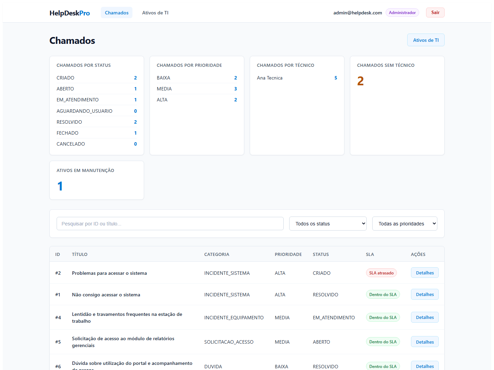
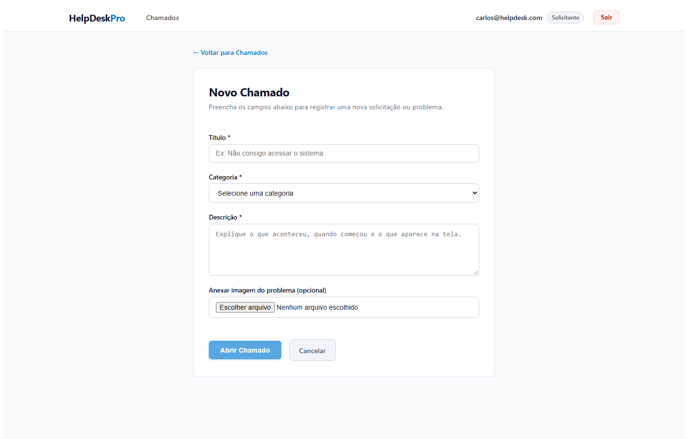
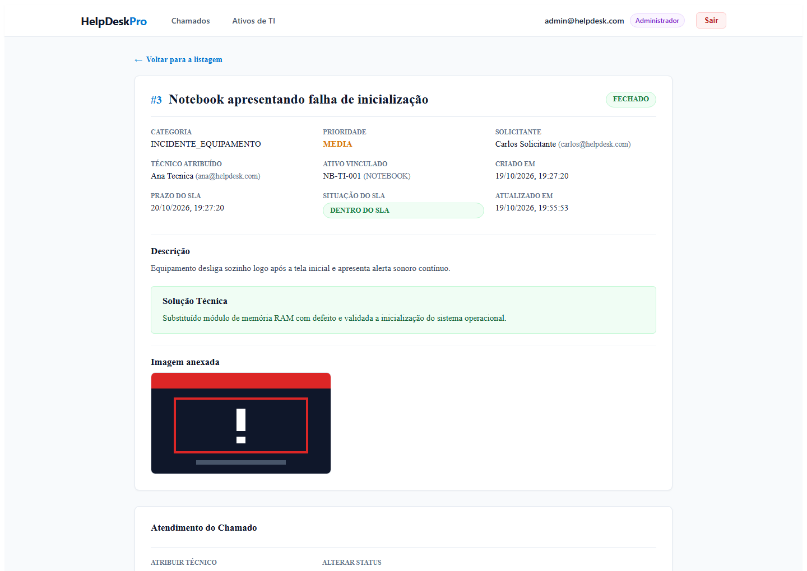
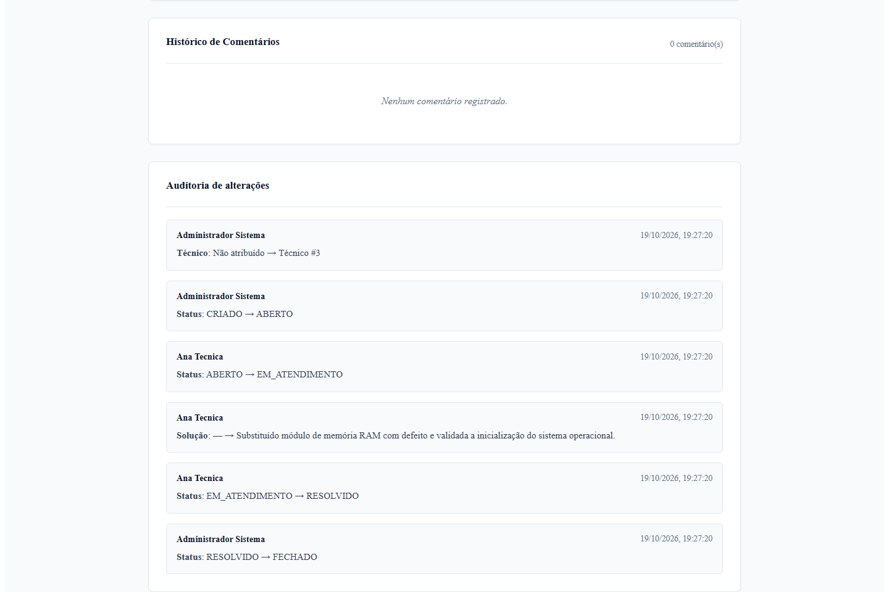
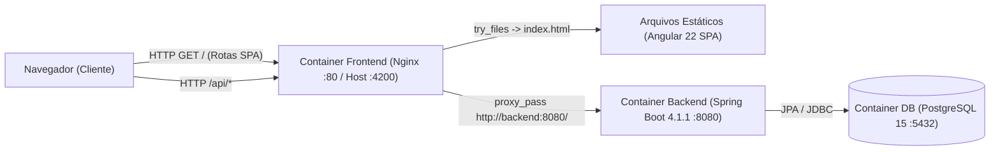
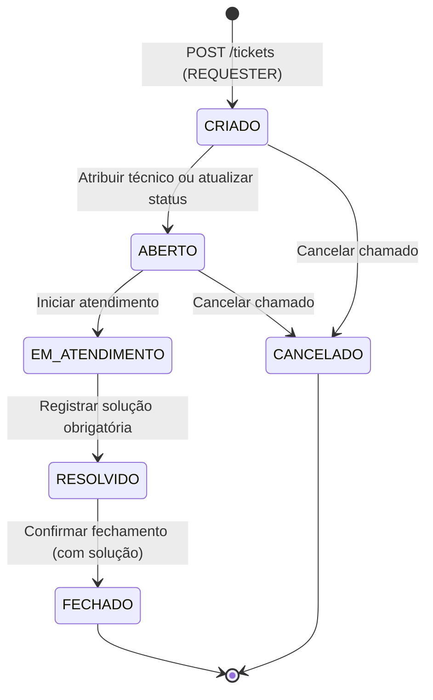

# HelpDesk Pro

[](https://github.com/chicoalive/helpdesk-pro/actions/workflows/ci.yml)

Sistema full stack para gestão de chamados de suporte técnico e inventário de ativos de TI. Conta com controle de acesso por perfil (RBAC), máquina de estados de atendimento, cálculo automático de SLA, trilha de auditoria de alterações, prevenção de chamados duplicados e ambiente completo em Docker Compose. Desenvolvido com **Java 21**, **Spring Boot 4.1.1**, **PostgreSQL** e **Angular 22**.

> 📖 O histórico detalhado de engenharia por etapas está disponível em [`docs/ROADMAP.md`](docs/ROADMAP.md).

---

## Screenshots

### Dashboard


### Abertura de chamado


### Atendimento e detalhes


### Auditoria


---

## Funcionalidades principais

- **Abertura e gestão de chamados:** criação de chamados pelo solicitante com cálculo automático de prioridade por categoria e acompanhamento completo do ciclo de vida.
- **Gestão de ativos de TI:** cadastro, edição, controle de status (`IN_USE`, `UNDER_MAINTENANCE`, `INACTIVE`, `DISCARDED`) e vínculo obrigatório de equipamento em uso para incidentes de hardware.
- **Perfis de acesso (`ADMIN`, `TECHNICIAN`, `REQUESTER`):** permissões segregadas no Spring Security e nas rotas/componentes do Angular, com vocabulário amigável para usuários finais e visão técnica para a equipe de suporte.
- **Controle de SLA automático:** cálculo derivado de prazo de atendimento (`4h` para prioridade `ALTA`, `24h` para `MEDIA` e `72h` para `BAIXA`) com indicador visual de atraso.
- **Auditoria de alterações:** rastreamento automático de mudanças de técnico atribuído, status e solução técnica (autor, data/hora, valor anterior e novo valor).
- **Dashboard operacional:** indicadores em tempo real de chamados por status, prioridade, técnico responsável, chamados sem atribuição e ativos em manutenção.
- **Anexos de evidência:** upload e visualização de imagem (`PNG` ou `JPG/JPEG` de até 2 MB) vinculada ao chamado.
- **Prevenção de duplicidade:** bloqueio inteligente de chamados ativos repetidos para a mesma categoria crítica ou mesmo equipamento, direcionando o usuário para o chamado já em andamento.
- **Comprovante de chamado:** layout formatado para impressão direta do protocolo pelo navegador.
- **Painel de atendimento técnico:** atribuição de técnico, avanço de status e registro de solução técnica diretamente na tela de detalhes, com atualização imediata da auditoria.

---

## Stack tecnológica

- **Backend:** Java 21, Spring Boot 4.1.1, Spring WebMVC, Spring Data JPA, Bean Validation, Spring Security + JWT (`java-jwt` 4.4.0), Springdoc OpenAPI 3.1.1, Gradle
- **Frontend:** Angular 22, TypeScript 6, RxJS 7.8, Vitest 5, Node.js 24
- **Banco de Dados:** PostgreSQL 15
- **Infraestrutura e CI:** Docker, Docker Compose, Nginx, GitHub Actions

---

## Destaques técnicos

- **Autenticação e autorização com JWT e RBAC:** endpoints e rotas protegidos por papel (`ADMIN`, `TECHNICIAN`, `REQUESTER`) com validação de propriedade dos recursos no domínio.
- **Máquina de estados estrita:** transições de status validadas no serviço de domínio, exigindo preenchimento de solução técnica antes da resolução ou fechamento.
- **SLA derivado sem acoplamento de persistência:** prazos e alertas de violação calculados de forma determinística a partir da prioridade e do instante de criação.
- **Trilha de auditoria consistente:** registros gerados exclusivamente dentro das transações reais de atribuição de técnico, mudança de status e solução.
- **Docker Compose Full Stack:** build multi-stage para backend (JDK 21 → JRE 21 Alpine) e frontend (Node 24 Alpine → Nginx Alpine), com seed idempotente de dados de demonstração.
- **Pipeline de CI no GitHub Actions:** execução automatizada da suíte de testes do backend e testes/build do frontend a cada `push` ou `pull_request` na branch `main`.
- **321 testes automatizados:** cobertura abrangente de regras de negócio, segurança, contratos REST, componentes e serviços.

---

## Arquitetura



---

## Máquina de estados

Diagrama baseado exclusivamente nas transições permitidas por `TicketService`:



---

## Testes e qualidade

- **Backend:** **176 testes aprovados** (testes unitários com JUnit 5 / Mockito e testes de integração com `@SpringBootTest`, `MockMvc` e banco **H2** em memória em modo de compatibilidade PostgreSQL).
- **Frontend:** **145 testes aprovados** distribuídos em 16 suítes (Vitest + Angular TestBed).
- **Total:** **321 testes automatizados** passando.
- **Integração Contínua:** o workflow [`.github/workflows/ci.yml`](.github/workflows/ci.yml) valida automaticamente os testes do backend, os testes unitários do frontend e o build de produção em cada `push` e `pull_request` para `main`.

---

## Como executar

### Usando Docker Compose (Recomendado)

Pré-requisito: **Docker** e **Docker Compose** instalados.

1. Clone o repositório:

```bash
git clone https://github.com/chicoalive/helpdesk-pro.git
cd helpdesk-pro
```

2. Crie o arquivo `.env` a partir do modelo `.env.example` e defina uma senha local para o banco em `POSTGRES_PASSWORD`:

```bash
cp .env.example .env
```

3. Construa e inicie todos os containers (PostgreSQL + Backend + Frontend/Nginx com dados de demonstração habilitados):

```bash
docker compose up -d --build
```

4. Acesse os serviços:
   - **Frontend (Aplicação Web):** `http://localhost:4200`
   - **Backend (API REST):** `http://localhost:8080`
   - **Swagger UI (Documentação OpenAPI):** `http://localhost:8080/swagger-ui/index.html`

5. Para encerrar os containers:

```bash
docker compose down
```

<details>
<summary><strong>Execução manual para desenvolvimento (Java 21 + Node 24)</strong></summary>

1. Com uma instância PostgreSQL ativa contendo o banco `helpdesk`, inicie o backend na pasta `backend/`:
   ```bash
   # Linux / macOS
   ./gradlew bootRun

   # Windows (PowerShell)
   .\gradlew.bat bootRun
   ```
2. Em outro terminal, inicie o servidor de desenvolvimento do Angular na pasta `frontend/`:
   ```bash
   npm ci
   npm start
   ```
3. Para executar as suítes de testes localmente:
   ```bash
   # Backend (na pasta backend/)
   .\gradlew.bat test

   # Frontend (na pasta frontend/)
   npm test -- --watch=false
   npm run build
   ```
</details>

---

## Credenciais de demonstração

Ao iniciar o ambiente via Docker Compose (`APP_SEED_DEMO_ENABLED=true`), o sistema disponibiliza automaticamente as seguintes contas para avaliação local:

| Perfil | E-mail | Senha |
| :--- | :--- | :--- |
| **Administrador (`ADMIN`)** | `admin@helpdesk.com` | `123` |
| **Técnico (`TECHNICIAN`)** | `ana@helpdesk.com` | `123` |
| **Solicitante (`REQUESTER`)** | `carlos@helpdesk.com` | `123` |

> ⚠️ *Nota: credenciais exclusivas para ambiente local de demonstração e avaliação técnica.*

---

## Estrutura resumida

```text
helpdesk-pro/
├── .github/workflows/   # Pipeline de CI (GitHub Actions - testes e build)
├── backend/             # API REST Spring Boot 4.1.1 (Java 21, Gradle, JPA, Security/JWT)
├── frontend/            # SPA Angular 22 + configuração de build Docker e Nginx
├── docs/                # Histórico de engenharia (ROADMAP.md) e assets de documentação
└── docker-compose.yml   # Orquestração full stack (PostgreSQL + Backend + Frontend)
```
