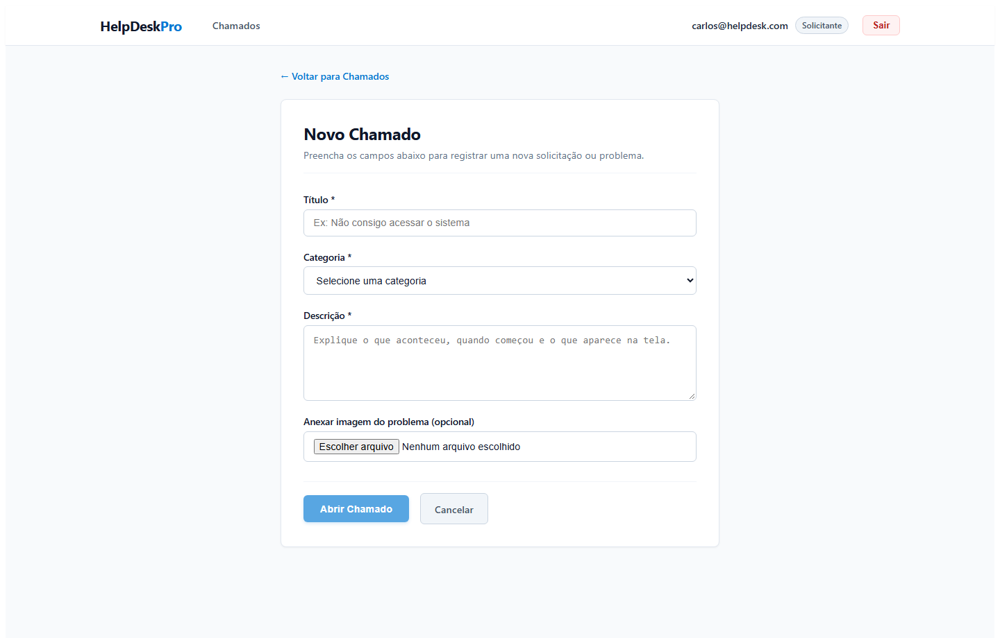
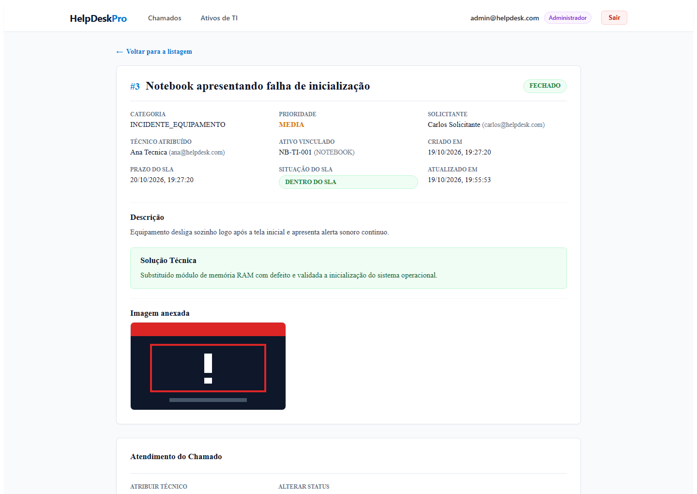
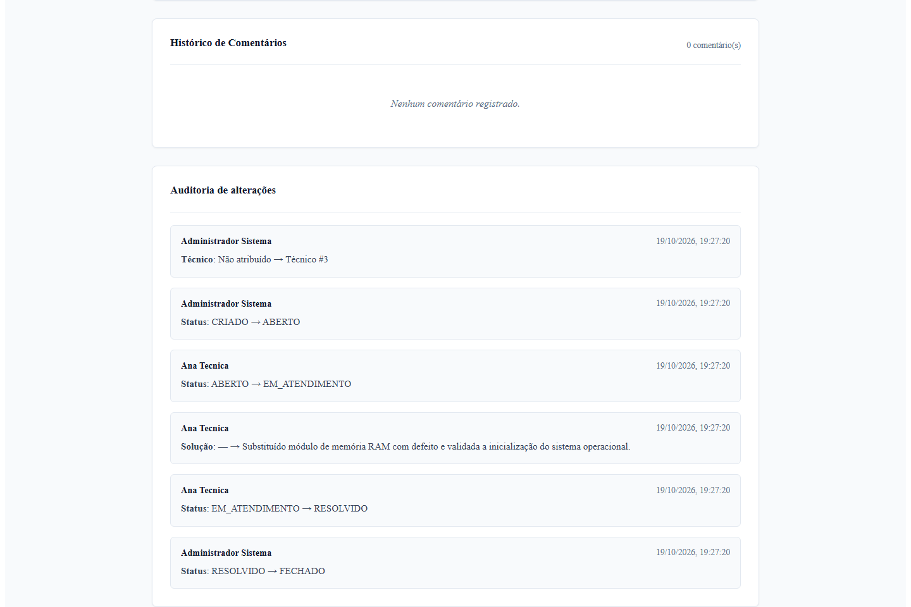
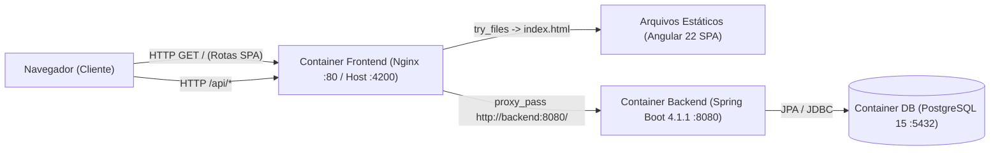
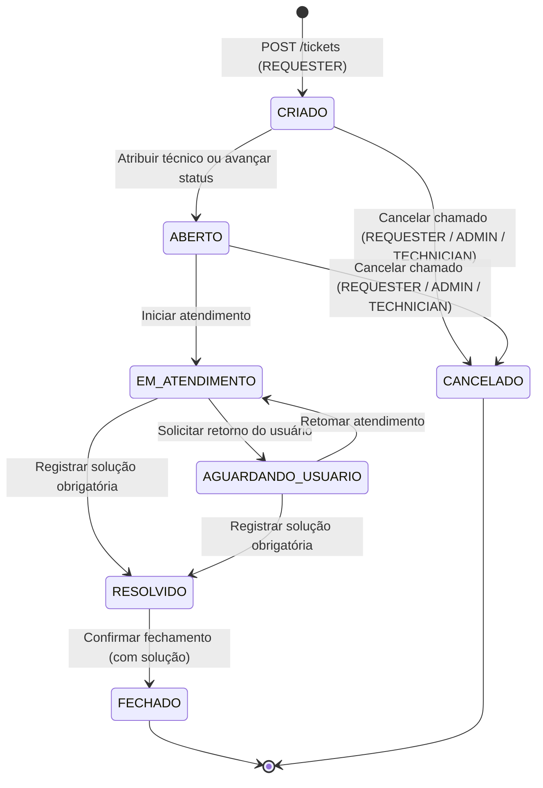

# Meu Assistente TI

[](https://github.com/chicoalive/helpdesk-pro/actions/workflows/ci.yml)

Sistema full stack para gestão de chamados de suporte técnico, administração de usuários e inventário de ativos de TI. Conta com controle de acesso por perfil (RBAC), máquina de estados completa de atendimento, cálculo automático de SLA, trilha de auditoria de alterações, prevenção de chamados duplicados e ambiente completo em Docker Compose. Desenvolvido com **Java 21**, **Spring Boot 4.1.1**, **PostgreSQL** e **Angular 22**.

> 📖 O histórico detalhado de engenharia por etapas está disponível em [`docs/ROADMAP.md`](docs/ROADMAP.md).

---

## Screenshots

### Dashboard


### Abertura de chamado


### Atendimento e detalhes


### Auditoria


---

## Funcionalidades principais

- **Abertura e gestão de chamados:** criação de chamados pelo solicitante com cálculo automático de prioridade por categoria, acompanhamento completo do ciclo de vida e cancelamento pelo próprio solicitante enquanto o chamado estiver `CRIADO` ou `ABERTO`.
- **Gestão administrativa de usuários (`/users`):** tela exclusiva para administradores com listagem, filtro por perfil/busca e cadastro, edição, desativação e reativação de Administradores (`ADMIN`), Técnicos (`TECHNICIAN`) e Solicitantes (`REQUESTER`), com auditoria e proteção do último administrador ativo.
- **Gestão de ativos de TI (`/assets`):** cadastro, edição, controle de status (`IN_USE`, `UNDER_MAINTENANCE`, `INACTIVE`, `DISCARDED`) e vínculo obrigatório de equipamento em uso para incidentes de hardware.
- **Perfis de acesso (`ADMIN`, `TECHNICIAN`, `REQUESTER`):** permissões segregadas no Spring Security e nas rotas/componentes do Angular, com vocabulário amigável para usuários finais e visão técnica para a equipe de suporte.
- **Painel de atendimento técnico e comentários:** auto-atribuição em 1 clique ("Assumir chamado") para técnicos, envio e histórico de comentários em tempo real, transições filtradas conforme o status atual (incluindo `AGUARDANDO_USUARIO`) e registro de solução técnica.
- **Controle de SLA automático:** cálculo derivado de prazo de atendimento (`4h` para prioridade `ALTA`, `24h` para `MEDIA` e `72h` para `BAIXA`) com indicador visual de atraso.
- **Auditoria de alterações:** rastreamento automático de mudanças de técnico atribuído, status e solução técnica (autor, data/hora, valor anterior e novo valor).
- **Dashboard operacional:** indicadores em tempo real de chamados por status, prioridade, técnico responsável, chamados sem atribuição e ativos em manutenção.
- **Anexos de evidência:** upload e visualização de imagem (`PNG` ou `JPG/JPEG` de até 2 MB) vinculada ao chamado, com listagem otimizada sem tráfego desnecessário de bytes em memória.
- **Prevenção de duplicidade:** bloqueio inteligente de chamados ativos repetidos para a mesma categoria crítica ou mesmo equipamento, direcionando o usuário para o chamado já em andamento.
- **Comprovante de chamado:** layout formatado para impressão direta do protocolo pelo navegador.

---

## Stack tecnológica

- **Backend:** Java 21, Spring Boot 4.1.1, Spring WebMVC, Spring Data JPA, Bean Validation, Spring Security + JWT (`java-jwt` 4.4.0), Springdoc OpenAPI 3.1.1, Gradle
- **Frontend:** Angular 22, TypeScript 6, RxJS 7.8, Vitest 5, Node.js 24
- **Banco de Dados:** PostgreSQL 15
- **Infraestrutura e CI:** Docker, Docker Compose, Nginx, GitHub Actions

---

## Destaques técnicos

- **Autenticação e autorização com JWT, RBAC e validação de expiração:** endpoints e rotas protegidos por papel (`ADMIN`, `TECHNICIAN`, `REQUESTER`), validação de expiração do token no cliente e proteção de propriedade dos recursos no domínio.
- **Máquina de estados estrita:** transições de status validadas no serviço de domínio e refletidas dinamicamente na interface, exigindo preenchimento de solução técnica antes da resolução ou fechamento.
- **Consultas JPA otimizadas:** projeção leve nas listagens de chamados evitando o carregamento de arrays binários (`byte[]`) de anexos em memória.
- **SLA derivado sem acoplamento de persistência:** prazos e alertas de violação calculados de forma determinística a partir da prioridade e do instante de criação.
- **Trilha de auditoria consistente:** registros gerados exclusivamente dentro das transações reais de atribuição de técnico, mudança de status e solução.
- **Docker Compose Full Stack e perfil de produção seguro:** build multi-stage para backend (JDK 21 → JRE 21 Alpine) e frontend (Node 24 Alpine → Nginx Alpine), exigência explícita de `JWT_SECRET`, configuração de CORS por variável de ambiente e seed idempotente com proteção das contas de demonstração.
- **Pipeline de CI no GitHub Actions:** execução automatizada da suíte de testes do backend e testes/build do frontend a cada `push` ou `pull_request` na branch `main`.
- **452 testes automatizados:** cobertura abrangente de regras de negócio, segurança, contratos REST, componentes, guards e serviços.

---

## Arquitetura



---

## Máquina de estados

Diagrama baseado exclusivamente nas transições permitidas por `TicketService`:



---

## Testes e qualidade

- **Backend:** **238 testes aprovados** (testes unitários com JUnit 5 / Mockito e testes de integração com `@SpringBootTest`, `MockMvc` e bancos **H2** e **PostgreSQL real isolado**).
- **Frontend:** **214 testes aprovados** distribuídos em 23 arquivos (Vitest + Angular TestBed).
- **Total:** **452 testes automatizados** passando.
- **Integração Contínua:** o workflow [`.github/workflows/ci.yml`](.github/workflows/ci.yml) valida automaticamente os testes do backend, os testes unitários do frontend e o build de produção em cada `push` e `pull_request` para `main`.

---

## Como executar

### Usando Docker Compose (Recomendado)

Pré-requisito: **Docker** e **Docker Compose** instalados.

1. Clone o repositório:

```bash
git clone https://github.com/chicoalive/helpdesk-pro.git
cd helpdesk-pro
```

2. Crie o arquivo `.env` a partir do modelo `.env.example` e defina a senha do banco (`POSTGRES_PASSWORD`) e um segredo JWT (`JWT_SECRET` exclusivo, aleatório e com pelo menos 32 caracteres):

```bash
cp .env.example .env
```

3. Construa e inicie todos os containers (PostgreSQL + Backend + Frontend/Nginx):

```bash
docker compose up -d --build
```

4. Em uma instalação nova, abra um terminal interativo na pasta do projeto e execute:

```bash
docker compose run --rm --no-deps backend provision-admin
```

Informe nome, e-mail e senha e confirme a senha. O terminal oculta a digitação.
Use pelo menos 12 caracteres e no máximo 72 bytes em UTF-8. O comando usa o banco
da instalação, exige que o backend já tenha inicializado o esquema e termina após
a operação. Se já existir qualquer administrador, a criação é recusada.

5. Acesse os serviços:
   - **Frontend (Aplicação Web):** `http://localhost:4200`
   - **Backend (API REST):** `http://localhost:8080`
   - **Swagger UI (Documentação OpenAPI):** `http://localhost:8080/swagger-ui/index.html`

6. Para encerrar os containers:

```bash
docker compose down
```

<details>
<summary><strong>Execução manual para desenvolvimento (Java 21 + Node 24)</strong></summary>

1. Com uma instância PostgreSQL ativa contendo o banco `helpdesk`, inicie o backend na pasta `backend/`:
   ```bash
   # Linux / macOS
   ./gradlew bootRun

   # Windows (PowerShell)
   .\gradlew.bat bootRun
   ```
2. Em outro terminal, inicie o servidor de desenvolvimento do Angular na pasta `frontend/`:
   ```bash
   npm ci
   npm start
   ```
3. Para executar as suítes de testes localmente:
   ```bash
   # Backend (na pasta backend/)
   .\gradlew.bat test

   # Frontend (na pasta frontend/)
   npm test -- --watch=false
   npm run build
   ```
</details>

---

### Edição de contas

Na gestão de usuários, a ação Editar reutiliza o formulário e permite alterar
nome, e-mail e perfil. Senha, ID e estado ativo não são editáveis nessa tela.
Salvar envia a versão carregada da conta; dados desatualizados recebem HTTP 409
e exigem recarregar a conta antes de uma nova tentativa.

A migração V4 acrescenta a versão de edição, o histórico dos campos não sensíveis
e uma proteção transacional do último administrador ativo no PostgreSQL.
A API usa bloqueios ordenados e valida a autorização atual do responsável.
Edições reais geram USER_UPDATED e seus valores anteriores e novos na mesma
transação. Mudanças em e-mail ou perfil revogam as sessões; mudanças só no nome
preservam a sessão. Alterar o próprio e-mail ou perfil exige entrar novamente.
### Cadastro administrativo

Administradores podem cadastrar Administrador, Técnico e Solicitante pela tela
de usuários. Novas senhas exigem no mínimo 12 caracteres e no máximo 72 bytes
UTF-8, sem remoção automática de espaços. Nome e e-mail são normalizados antes
da validação; e-mails têm unicidade também por forma normalizada no PostgreSQL.

A migração V3 adiciona a auditoria de contas. Cada cadastro registra, na mesma
transação, o administrador responsável, o usuário criado, o perfil atribuído,
a operação USER_CREATED e o instante UTC. Senhas, hashes e JWTs não integram
esses eventos. Os eventos históricos de chamados permanecem em sua tabela
original. Contas preexistentes não recebem eventos de criação retroativos.
### Evolução do banco e sessões

O backend usa Flyway em PostgreSQL. Bancos novos executam a V1 (esquema inicial)
e V2–V6 (sessões, gestão e auditoria de contas e recuperação). Instalações legadas sem Flyway recebem baseline na V1 e executam V2–V6. Bancos já versionados executam somente as migrações pendentes. O Hibernate valida o esquema após as migrações.
Faça backup e homologue uma restauração isolada antes de atualizar a instalação.

A V2 mantém os usuários existentes ativos e com versão de sessão zero. Não
altera senhas, perfis ou vínculos de chamados. Os JWTs passam a identificar a
conta pelo ID imutável e incluem a versão de sessão. Tokens antigos exigem novo
login. Em cada requisição, o backend confere atividade, versão e permissões da
conta no banco. Edição, estado da conta e recuperação utilizam essa base de revogação.
### Atualização de uma instalação existente

Faça um backup verificável do PostgreSQL e anote qual conta administrativa já
consegue entrar. Antes de atualizar, confirme que você possui acesso a uma conta
administrativa com senha exclusiva da instalação. Se só houver contas com
credenciais conhecidas, prepare primeiro uma conta administrativa exclusiva pelo
endpoint autenticado `POST /users`, que aceita o perfil `ADMIN`. Valide o login
dessa conta em uma sessão independente.

Ao aplicar a atualização, mantenha o mesmo projeto Compose, banco e volume.
Remova qualquer ativação de `APP_SEED_DEMO_ENABLED` da configuração de produção.
Não execute `provision-admin` para substituir uma conta existente. Valide o login
e confira usuários, ativos, chamados, comentários e anexos após a atualização.
Esta etapa preserva as contas antigas e suas senhas. Se ainda houver contas com
credenciais conhecidas, mantenha o acesso ao sistema restrito até tratar essas
credenciais em uma intervenção autorizada.

## Credenciais de demonstração

A demonstração é desabilitada por padrão. Para ativá-la, use uma cópia separada
do projeto com configuração própria, banco vazio e um nome de projeto Compose
distinto. Em seu arquivo de ambiente, defina `APP_SEED_DEMO_ENABLED=true` antes
de iniciar os serviços. Se os ambientes estiverem ativos ao mesmo tempo, use
portas publicadas distintas. A demonstração cria as contas abaixo e pode
restaurar o perfil e a senha dessas contas ao reiniciar:

| Perfil | Nome | E-mail | Senha |
| :--- | :--- | :--- | :--- |
| **Administrador (`ADMIN`)** | Administrador Sistema | `admin@helpdesk.com` | `123` |
| **Técnico (`TECHNICIAN`)** | Ana Tecnica | `ana@helpdesk.com` | `123` |
| **Solicitante (`REQUESTER`)** | Carlos Solicitante | `carlos@helpdesk.com` | `123` |

> ⚠️ *Nota: credenciais exclusivas para ambiente de demonstração e avaliação técnica.*

---

## Estrutura resumida

```text
helpdesk-pro/
├── .github/workflows/   # Pipeline de CI (GitHub Actions - testes e build)
├── backend/             # API REST Spring Boot 4.1.1 (Java 21, Gradle, JPA, Security/JWT)
├── frontend/            # SPA Angular 22 + configuração de build Docker e Nginx
├── docs/                # Histórico de engenharia (ROADMAP.md) e assets de documentação
└── docker-compose.yml   # Orquestração full stack (PostgreSQL + Backend + Frontend)
```


### Desativação e reativação de contas

Na Gestão de Usuários, administradores podem filtrar contas por estado, confirmar a desativação e reativar contas. Não há exclusão física nem alteração automática de senha ou perfil. A própria conta não pode ser desativada. O último administrador ativo permanece protegido na aplicação e pelo mecanismo transacional da V4 no PostgreSQL.

`PATCH /users/{id}/state` aceita apenas `active` e `expectedVersion`. Versões desatualizadas recebem HTTP 409. Uma alteração efetiva incrementa a versão de edição e de sessão. JWTs anteriores permanecem inválidos mesmo após reativar a conta. A operação e o evento `USER_DEACTIVATED` ou `USER_REACTIVATED`, com administrador responsável e estados anterior/novo, são persistidos na mesma transação. Repetições sem alteração não geram auditoria.

A V5 amplia somente os campos permitidos na auditoria administrativa para incluir `active`. Não altera V1–V4 nem o estado das contas existentes. Chamados, comentários, anexos e ativos são preservados. Técnicos inativos não recebem novas atribuições. Um administrador pode reatribuir um chamado cujo técnico esteja inativo pelo fluxo existente, sem reatribuição automática e mantendo a auditoria do chamado.


### Regressões da homologação integrada 14.1B

A reatribuição administrativa também permanece disponível quando o responsável anterior deixa o perfil Técnico, sem alterar automaticamente o chamado. A atribuição utiliza bloqueio transacional do chamado e do técnico de destino, impedindo que duas atribuições simultâneas sejam aceitas e sobrescritas silenciosamente.

A homologação acrescentou o cenário `CompanyWorkflowPostgresIntegrationTest`, com instalação nova, provisionamento local, sete contas fictícias, equipamentos, chamado com imagem e comentários, edição, revogação, desativação, reativação, rollback real de auditoria e concorrência. Ele exige explicitamente PostgreSQL descartável e as variáveis de teste `HELPDESK_COMPANY_DB` e `HELPDESK_COMPANY_PASSWORD`, além das variáveis `HELPDESK_DISPOSABLE_TEST_PG_*`. Não deve apontar para o banco principal. A senha de teste deve ser fornecida apenas no ambiente do processo, sem registrá-la em comandos ou arquivos de texto.


## Etapa 14.1C — Recuperação e redefinição de senhas

No login, **Esqueci minha senha** abre a solicitação pública. O funcionário informa o e-mail e procura o administrador por um canal confiável. A resposta é igual para contas aptas, desconhecidas ou inativas. O sistema não envia e-mails nesta versão.

Em **Gestão de Usuários → Solicitações de recuperação de acesso**, um ADMIN analisa a solicitação e confirma que verificou a identidade. Ao emitir, recebe uma autorização aleatória de 256 bits, exibida somente naquele momento. Deve entregá-la diretamente ao titular, sem incluí-la em URL, chamado ou canal compartilhado. A autorização expira em 15 minutos, só pode ser usada uma vez e é armazenada exclusivamente por SHA-256. Se a cópia for perdida, revogue a autorização e peça uma nova solicitação; a listagem não permite recuperá-la.

Em **Tenho uma autorização**, o funcionário informa o código e a nova senha duas vezes. A senha deve ter ao menos 12 caracteres, letras e números, e até 72 bytes UTF-8. BCrypt continua sendo usado para armazenamento. A conclusão revoga todos os JWTs anteriores da conta, preservando seu ID, perfil e histórico. Alteração sensível da conta ou desativação também invalida autorizações já emitidas. Contas inativas não recebem recuperação pública nem podem consumir autorização.

A limitação de frequência persiste no PostgreSQL: até 20 solicitações por minuto por origem observada pela API, 3 por e-mail por hora e 5 tentativas de redefinição por minuto por origem. Atrás do Nginx, a origem observada pode ser compartilhada; o limite por e-mail continua independente. Respostas de solicitação permanecem genéricas mesmo ao limitar. A redefinição limitada retorna HTTP 429. Tentativas inválidas não desfazem o contador.

A V6 adiciona solicitações, hashes de autorização, controle de frequência e o vínculo da auditoria à solicitação. Eventos públicos têm responsável anônimo explícito; aprovação, rejeição e emissão registram o ADMIN autenticado. Não são registrados senhas, hashes de senha ou autorizações. Alteração e auditoria são transacionais; falha na auditoria desfaz a operação. Aprovações concorrentes usam a versão da solicitação e apenas uma emissão vence. Redefinições concorrentes consomem a autorização uma única vez.

### Recuperação do administrador e credencial Windows

Se há outro ADMIN ativo, ele pode autorizar a recuperação após verificar a identidade. Uma sessão administrativa ainda válida também permite autorizar a recuperação da própria conta. Sem sessão válida ou outro ADMIN, o responsável pela instalação deve recuperar a credencial já protegida no Windows; não há cadastro administrativo público, senha mestra ou alteração de hash por SQL.

O responsável deve guardar a credencial em armazenamento protegido e manter o caminho no inventário privado da instalação. Consulte [Continuidade administrativa](docs/CONTINUIDADE-ADMINISTRATIVA.md), inclusive a limitação quando não existe outra conta, sessão ou credencial recuperável.

### Testes PostgreSQL e configuração local

`JWT_SECRET` é obrigatório também no desenvolvimento: não existe segredo JWT de fallback. Forneça-o no ambiente do processo, sem colocá-lo em comandos ou arquivos versionados. As propriedades de teste utilizam valores fictícios exclusivos para testes.

O Compose publica portas somente em `127.0.0.1`; a instalação não é publicada na rede. Demonstração permanece explicitamente desabilitada no modelo de ambiente.

Para executar todos os 238 testes do backend, disponibilize uma instância PostgreSQL **descartável e separada do principal**, com permissão de criar bancos. Configure, somente no ambiente do processo:

- `HELPDESK_DISPOSABLE_TEST_PG_URL`: JDBC do banco descartável de controle.
- `HELPDESK_DISPOSABLE_TEST_PG_USER` e `HELPDESK_DISPOSABLE_TEST_PG_PASSWORD`.
- `HELPDESK_COMPANY_DB`: nome novo no formato `company_` seguido de caracteres hexadecimais.
- `HELPDESK_COMPANY_PASSWORD`: senha fictícia forte do cenário integrado.

Nunca aponte essas variáveis ao PostgreSQL de uso real. Os testes criam bancos/cenários próprios; sem essas variáveis, os testes PostgreSQL são pulados. O CI configura PostgreSQL efêmero e executa também essas integrações.

A consolidação das Etapas 14.1A–C está em [Homologação](docs/HOMOLOGACAO-14.1.md). O levantamento da próxima etapa está em [Etapa 14.2](docs/PLANO-14.2.md); não corresponde a funcionalidades já implementadas.